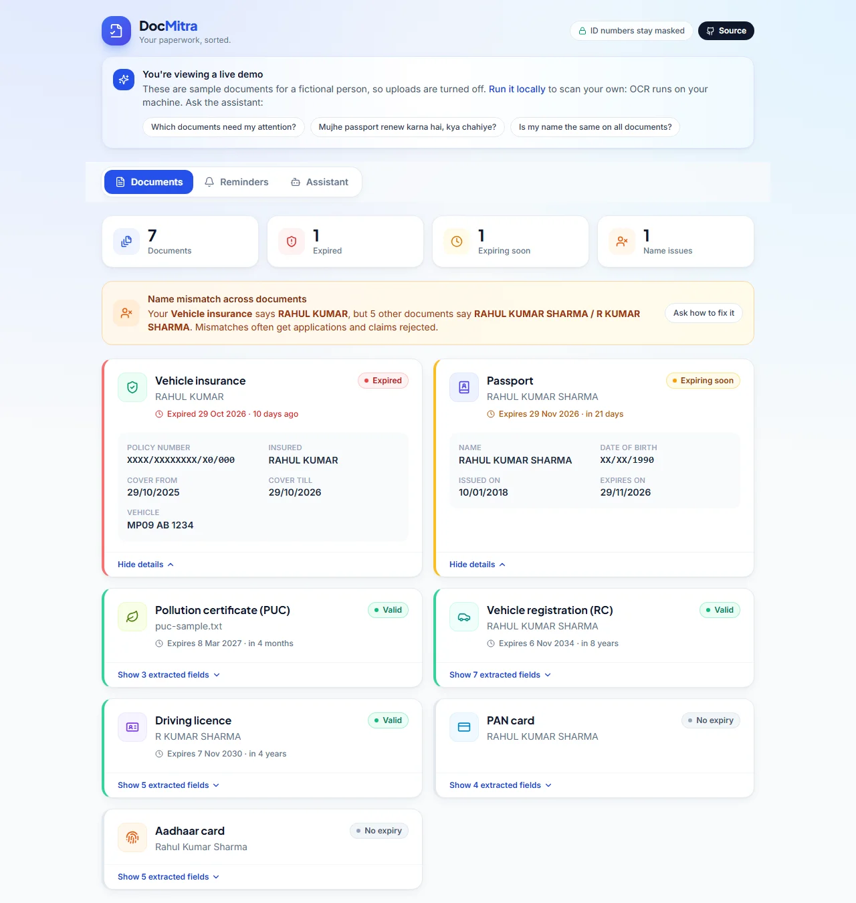

# DocMitra

[](https://github.com/AkshayTripathiAI/DocMitra/actions/workflows/ci.yml)
[](https://github.com/AkshayTripathiAI/DocMitra/actions/workflows/agent-eval.yml)

An AI assistant for personal paperwork in India. Scan your Aadhaar, PAN, driving
licence, passport, vehicle RC, insurance and PUC; DocMitra reads them, tracks
expiry dates, spots name mismatches across documents, and answers questions
like *"Mujhe passport renew karna hai, kya chahiye?"* using what you actually have.

**Live demo:** https://doc-mitra.vercel.app (sample documents for a fictional person; uploads are off in the public demo)



## How it works

```
                       ┌────────────── Ingest graph (LangGraph StateGraph, no LLM) ──────────────┐
 photo / PDF  ──────►  │ quality check ─► OCR ─► classify type ─► extract fields ─► summarise    │ ──► SQLite
                       │   (blur, glare)  (EasyOCR)  (keyword scoring)  (regex per type)  (expiry) │     + reminders
                       └─────────────────────────────────────────────────────────────────────────┘

 chat message  ──────►  Assistant agent (LangGraph create_agent + tools)  ──► reply
                         tools: list_my_documents · get_document_details · find_expiring_documents
                                check_name_consistency · get_procedure_checklist · add_reminder · list_reminders
```

- **Privacy by design:** OCR runs locally. The LLM only ever sees the masked summary
  (`XXXX XXXX 0123`), never raw OCR text, full ID numbers or the images.
- **Deterministic first:** document type, fields and expiry dates come from rules, so uploads
  work with no API key. The LLM is used only for the conversation.
- **Any model:** set `LLM_MODEL` to `google_genai:gemini-3.5-flash-lite` (default), `groq:openai/gpt-oss-120b`,
  `anthropic:claude-sonnet-5-5`, etc.

## Layout

```
backend/   FastAPI + LangGraph
  app/extraction/   ocr, quality, classify, fields, matching   (pure functions)
  app/agents/       ingest graph, assistant agent, tools, procedure checklists
  app/main.py       REST API
  tests/            pytest (synthetic data only, runs offline)
web/       Vite + React + TypeScript + Tailwind
```

## Run it

Ports are 8010 / 5174 so it can run next to other projects on 8000 / 5173.

```powershell
# backend
cd backend
python -m venv venv            # skip if venv/ exists
.\venv\Scripts\pip install -r requirements.txt
copy .env.example .env         # then add GOOGLE_API_KEY, GROQ_API_KEY or ANTHROPIC_API_KEY
.\venv\Scripts\python -m uvicorn app.main:app --reload --port 8010

# web (second terminal)
cd web
npm install
npm run dev                    # http://localhost:5174
```

Tests: `cd backend; .\venv\Scripts\python -m pytest -q`

The first OCR run downloads EasyOCR models (~100 MB) and takes ~15 s on CPU.

## Evaluation

Every push runs the tests and an extraction eval in CI, and the build fails if accuracy drops below
[`evals/thresholds.json`](backend/evals/thresholds.json). A weekly job runs an agent eval against the live demo.
Details and how to run them: [`backend/evals/RESULTS.md`](backend/evals/RESULTS.md).

**Extraction**: 210 labelled synthetic documents (7 types × 2 layouts × 5 people × 3 OCR-noise levels).
*Silent errors* are fields extracted with the wrong value, which is worse than a missing field.

| Metric | Before evals | Now |
|---|---:|---:|
| Field accuracy | 83.0% | **95.8%** |
| Field accuracy, heavy OCR noise | 68.8% | **91.5%** |
| Expiry date accuracy (drives reminders) | 80.7% | **99.3%** |
| Holder name accuracy (drives mismatch checks) | 83.3% | **96.1%** |
| Silent errors | 3.6% | **2.3%** |
| Document type classification | 100% | 100% |

Through real OCR (35 documents rendered to images, read by EasyOCR): field accuracy 95.2% → **99.4%**, expiry and
holder name **100%**, silent errors 1.8% → **0.6%**.

**Agent** (real model, real tools, demo documents): **10/10** cases pass: right tools 100%, required facts 100%,
**no ID leaks** (including a prompt-injection attempt), reply language matches the question 100%, median latency 1.8 s.

The eval drove the fixes: OCR-normalisation before extraction (repairing labels like `D0B`, dates like
`0I/O9/1984`, names like `RAME5H`), bilingual Hindi/English labels, position-aware PAN repair, VIN rules for
chassis numbers, and tolerant vehicle numbers. It also caught a production bug: a transient model error
surfaced as an HTTP 500; the agent now retries once and returns a clear 503.

## Public demo mode

`DEMO_MODE=true` seeds seven synthetic documents for a fictional person (dates are relative to today, so
there is always an expired, an expiring and a valid document plus a name mismatch), turns uploads and
deletes off, and rate-limits chat per IP. The hosted demo runs this way:

- **API:** Render free tier, Docker image built from `backend/requirements-demo.txt` (no EasyOCR/PyTorch,
  since nothing is scanned in demo mode). Blueprint: [`render.yaml`](render.yaml).
- **Web:** Vercel, root directory `web`, with `VITE_API_BASE` set to the API URL.

## Roadmap

- [x] **Phase 1, foundation:** ingest graph, 7 document types, expiry reminders, name-mismatch
      check, tool-calling assistant, web app
- [ ] **Phase 2, better reading:** vision-LLM fallback when regex extraction is weak (opt-in,
      masked), Hindi OCR, rotate/crop before OCR, PDF rasterising for scanned PDFs
- [ ] **Phase 3, multi-agent:** supervisor graph routing to specialist agents (Intake, Planner,
      Form-filler, Reminder) with human-in-the-loop approval before any action
- [ ] **Phase 4, product:** login + per-user data, encrypted storage, PWA install + camera
      capture, push / WhatsApp reminders, persistent chat memory (Postgres checkpointer)
- [ ] **Phase 5, evaluation:** labelled test set of document photos, extraction accuracy
      metrics, LangSmith traces for the agent

## Notes

- Procedure checklists are high-level and link to official portals; rules and fees change.
- Test data in `backend/tests/samples.py` is made up. Never commit real documents.
